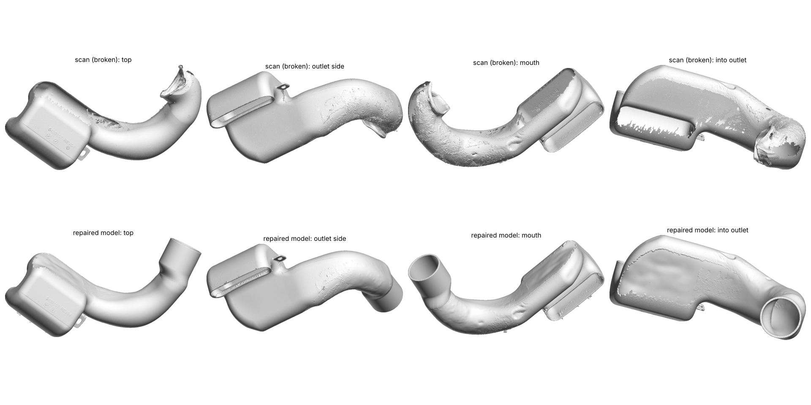
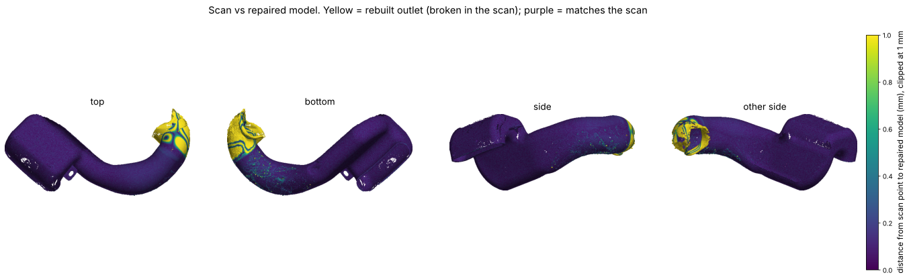
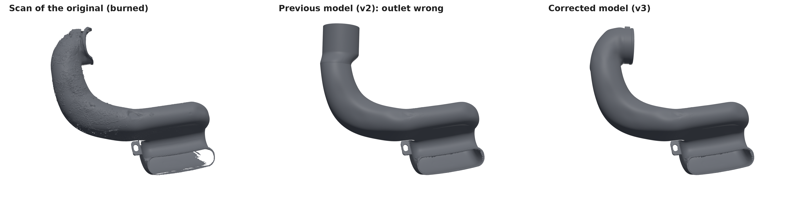
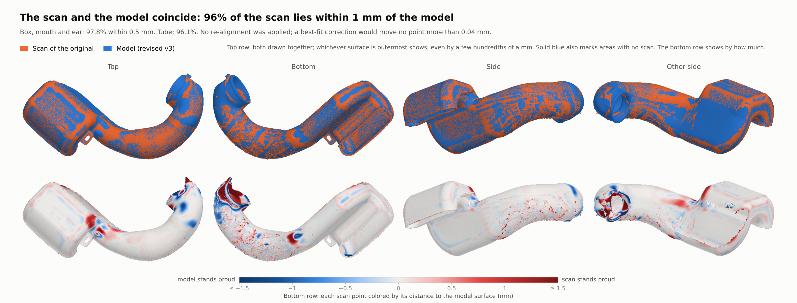
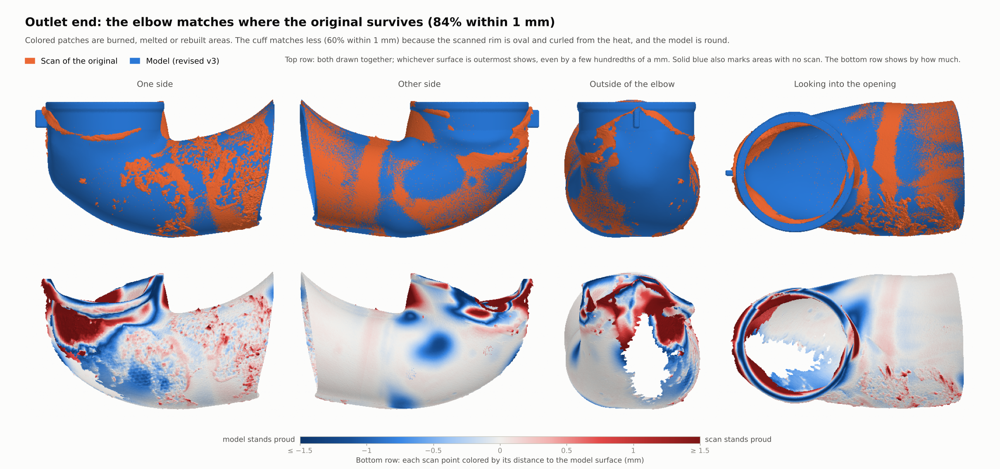
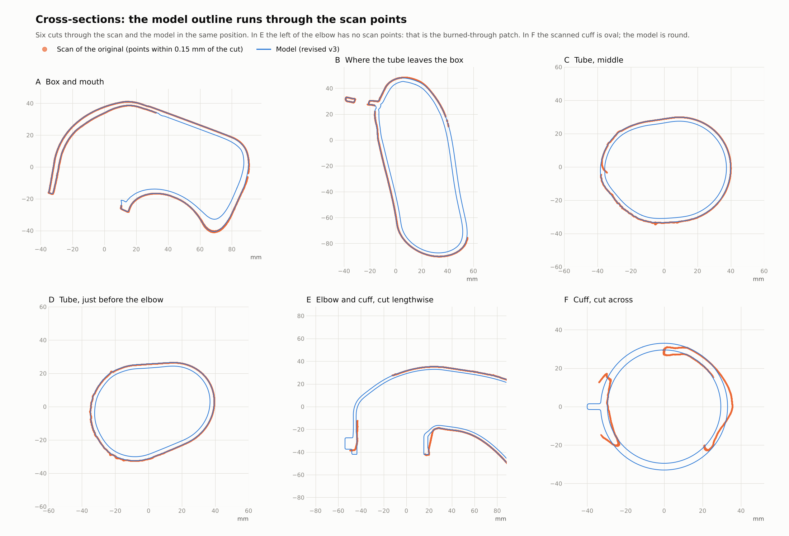

# Polaris 5439157 clutch outlet duct, repaired model

A printable STL of the Polaris **5439157 REV04 "Duct-Outlet, Clutch"**, rebuilt from a 3D scan of a
broken part (`Mesh_Tressa.stl`, about 20 million triangles). It is item 8 on the Polaris
"Clutch Cover and Ducting" diagram. It fits the 2014–2016 Sportsman 850 and 1000 Touring and SP
models, among others.

**Use [`polaris_5439157_outlet_duct_revised_v3.stl`](polaris_5439157_outlet_duct_revised_v3.stl).**
The three earlier STLs are kept for history, but their outlet end is wrong: it points the wrong way
(see "Revised v3" below). Do not print them.

First output: [`polaris_5439157_outlet_duct_repaired.stl`](polaris_5439157_outlet_duct_repaired.stl)

- Units are millimeters.
- The STL is in **the same coordinates as the scan**, so you can overlay the two directly.
- It is watertight, one solid body, 800k triangles.

## What was broken

From the scan and the customer's photos:

- The round outlet end that clamps to the clutch cover with a rubber coupler is torn off. What is
  left of it is crushed, folded, and has a torn flap sticking out.
- The J-bend next to it is scorched and abraded, with belt-cord residue melted into the surface
  and a hole worn through the wall. This is typical of a blown drive belt.
- The box, the rectangular mouth, the mounting ear and the rest of the tube are intact.

## What the model keeps and what was rebuilt

| region | how it was made |
|---|---|
| box, rectangular mouth, mounting ear, molded "5439157 REV04" text, upper tube | taken directly from the scan (see Verification) |
| melted and abraded J-bend | scan surface with about 1.2 mm of smoothing, which removes the belt residue and scorch texture but keeps the shape (median 0.12 mm from the scan) |
| outlet cuff | rebuilt as a straight round cuff on the axis measured from the intact tube end, then lofted into the last undamaged tube section |
| outlet-rim keying tab | added from photos of the OEM part: a flat tab on the outer side of the bend, just behind the cuff end (the scan only has a torn remnant) |
| small area between the box and the tube that the scanner could not reach (about 100 cm²) | smooth surface bridged from the surrounding scan |
| wall | 2.5 mm, 3.0 mm in the cuff. Wherever the scanner caught both faces of a wall (mouth collar, box end), the scanned thickness is kept. Two spots on the box that came out thinner than 1.4 mm (where the scanner missed the outside face) are brought up to 2.2 mm. |
| scan noise | about 120 tiny specks of stray scan points stuck to the outside surface are removed |

## Measurements

| feature | value |
|---|---|
| overall size (aligned) | 394 × 169 × 154 mm |
| outlet cuff outside diameter | **66.8 mm** |
| outlet cuff inside diameter | 60.8 mm (3.0 mm wall) |
| straight round cuff length | 50 mm, after a 22 mm loft from the oval tube |
| outlet-rim keying tab | 7 mm tall (radial), 10 mm long, 3 mm thick, ending 4 mm before the cuff end, on the outer side of the bend |
| tube section before the cuff | oval, about 78 × 56 mm, 225 mm outside perimeter |
| wall thickness elsewhere | 2.5 mm (scan shows about 2 mm at the box end and 3 mm at the outlet) |
| volume | 315 cm³, about 340 g in ASA, 360 g in PA6-CF, 400 g in PETG at full density |

[`reconstruction.json`](reconstruction.json) holds the cuff axis, center and the full set of build parameters.

## Please check before printing

These are the numbers I could not measure exactly, because that part of the original is missing or crushed:

1. **Cuff outside diameter, 66.8 mm.** This comes from circle fits to the surviving bottom and side
   wall of the cuff (R = 33.2–33.4 mm). If you have the rubber coupler or the clutch cover outlet,
   check the coupler's inside diameter. To change the diameter, edit `Ro` in `scripts/params_in.json`
   and re-run `build.py`, `final_mesh.py` and `export.py`.
2. **Cuff length.** The cuff ends 36 mm past the measured outlet section, where the furthest
   surviving piece of the original wall ends. The original might have been slightly longer, but not
   shorter.
3. **Rim tab.** Modeled from photos of the OEM part, not measured: the scan only has a torn
   remnant at that spot. Its size and its position around the rim should be checked against the
   slot in the rubber coupler (or a photo of an undamaged duct). Its settings are in
   `scripts/addtab.py`.
4. **Hidden area between the box and the tube.** This area is bridged smoothly, not measured.
   It doesn't touch a mating part.

## Verification

Distances from the scan points to the repaired model (`verification/verification.json`):

| region | median | 95th percentile | within 0.25 mm | within 0.5 mm |
|---|---|---|---|---|
| untouched (more than 160 mm from the outlet) | 0.10 mm | 0.20 mm | 98.6 % | 99.65 % |
| smoothed melted bend | 0.12 mm | 0.25 mm | 94.8 % | 99.3 % |
| rebuilt outlet (vs the broken scan) | 0.37 mm | 11 mm | 45 % | 53 % |

The first two rows show the model follows the scan to within scan noise. The few untouched-area points
further than 0.5 mm away are the removed noise specks and the inside face of the two thickened spots. The last row is large on purpose: there the model differs
from the broken scan by design (crushed, torn and missing material).

## Revised v3: outlet end corrected

[`polaris_5439157_outlet_duct_revised_v3.stl`](polaris_5439157_outlet_duct_revised_v3.stl) replaces the
outlet end. A test print of v2 next to the original showed the outlet did not match.

**What was wrong.** The scan has two openings at the burned end: the real outlet, and a hole burned
through the outside of the elbow. The first three models treated the burned side as the outlet and
built a straight cuff continuing the tube. On the real part the tube ends in a closed elbow, and the
outlet is a short round cuff on the inside of the hook that faces back toward the box. The old cuff
axis was 90 degrees off the real one.

**What v3 does.**

- **Cuff measured from its own walls.** A cylinder fitted to the intact band of the cuff (both wall
  faces, 2 to 16 mm below the rim) gives 66.0 mm outside, 59.0 mm inside, a 3.5 mm wall, with a fit
  error of 0.28 mm rms over about 220 degrees of the outside face. The rim is plain (67.8 mm across,
  no large lip) and sits 24 mm above the crease where the cuff meets the tube.
- **Elbow from the scan, completed by symmetry.** The elbow is mirror-symmetric about the plane
  through the cuff axis and the tube (0.56 mm median mismatch where both halves survive), so the
  intact half restores wall that burned away on the other half.
- **Burned-through patch refilled.** The hole on the outside of the elbow straddles the mirror
  plane, so nothing survives there. It is closed with a smooth minimum-bending surface that starts
  9 mm outside the hole's melted edge.
- **Cleaned like the rest.** Crust and melted flaps are removed and the elbow is smoothed without
  changing its size. The wall is 2.5 mm (median 2.6 mm, thinnest 1.6 mm in the crease between the
  cuff and the tube).
- **Everything else is revised v2, unchanged.** The model is cut across the tube just before the
  elbow and the new end is joined there. The step at the join is 0.03 mm (median), 0.34 mm at most.

| rebuilt end vs scan | median | within 1 mm | further than 3 mm |
|---|---|---|---|
| tube leading into the elbow | 0.14 mm | 99.8 % | 0 % |
| elbow body | 0.32 mm | 85 % | 2.2 % |
| outlet cuff | 0.81 mm | 57 % | 6.3 % |

The cuff numbers are low on purpose: the scanned rim is oval and curled from the heat, and the model
is round. The STL is watertight, one solid body, 920k triangles, 300 cm³, 372 x 175 x 154 mm.

**Still assumed, not measured:**

1. **Rim tab.** Same tab as before (7 x 10 x 3 mm), placed just under the rim on the side away from
   the tube. That part of the rim is burned away, so its position comes from photos of the sister part.
2. **Cuff roundness and diameter.** 66.0 mm is the best-fit circle of a heat-distorted rim. Check it
   against the rubber boot.
3. **The refilled patch** on the outside of the elbow is a smooth guess. It touches nothing.

Scripts: `scripts/outlet_v3/run_v3.sh` lists the steps in order. Labeled customer pictures are in
`customer/revised_v3/`, and the numbers above are in `verification/verification_revised_v3.json`.

### Superimposition check: revised v3 against the scan

The scan and the model are compared in the scan's own coordinates, with no re-alignment. A best-fit
correction on the box and tube would rotate the model 0.015 degrees and move no point more than
0.04 mm, so there is no alignment error to remove.

| region | scan points | median | within 0.5 mm | within 1 mm |
|---|---|---|---|---|
| box, mouth and mounting ear | 1.60 M | 0.02 mm | 97.8 % | 99.2 % |
| tube | 1.26 M | 0.05 mm | 96.1 % | 99.0 % |
| elbow at the outlet end | 0.35 M | 0.30 mm | 60.6 % | 84.1 % |
| outlet cuff | 0.12 M | 0.74 mm | 39.6 % | 59.6 % |
| whole scan | 3.33 M | 0.04 mm | 91.2 % | 96.2 % |

Distances are from scan points (every third point of the scan) to the nearest model surface.

- **Box and tube.** 0.9 % of these points are more than 1 mm from the model (2.4 mm at most), in
  three places: the underside where the tube flares into the box (about 6 cm², where the smooth
  tube rebuild flattened a small molded contour), the inside corner between the tube and the box
  next to the mounting ear (smoothed on request), and a spot by the mouth where a thin wall was
  thickened to 2.2 mm.
- **Elbow.** The differences are burned and melted areas, plus one side that is restored from the
  other half and stands 0.3 to 0.7 mm proud of the heat-affected scan.
- **Cuff.** The scanned cuff is oval: its outside radius varies from about 29 to 36 mm around the
  rim. The model is a round 66 mm, so they differ by up to 3.5 mm. This is the least certain part.

Scripts: `scripts/outlet_v3/superimpose.py` and `superimpose_fig.py`. Numbers: `verification/superimposition.json`.

## Revised version (fire damage and contaminants removed)

[`polaris_5439157_outlet_duct_revised.stl`](polaris_5439157_outlet_duct_revised.stl) is a second,
cleaner model. The first STL above is kept unchanged. The revised one aims for the part as
originally molded, before the fire: no scorch crust, no heat dents, no seams where the scanner
couldn't see.

- **Tube rebuilt as a design-intent sweep.** The original is blow-molded, so its tube is a smooth
  sweep. I fit one to the scan: a smoothed centerline with smooth cross-sections (14 angular
  harmonics, a cubic B-spline every 18 mm along the length). The fit is robust, so outward crust
  and inward dents count as outliers and don't pull the surface. About 4% of the tube scan was
  crust above the surface and 1% dents below it (see `verification/revised_tube_crust_and_dents.png`).
  The crushed last stretch before the outlet is left out of the fit and bridged by the sweep.
- **Box faces: smart smoothing.** A robust local surface fit (bilateral moving least squares)
  uses only neighbors on the same face, rejects outliers and caps each move at 1.5–2 mm. That
  removes the seam and waviness where the scanner missed the inside corner between the tube and
  the box, without rounding edges or shrinking the part.
- **Left untouched:** the mounting ear, the molded "5439157 REV04" text and recycling mark, the
  mouth lip, the rebuilt outlet cuff and the rim tab.
- **Tube wall** is a uniform 2.5 mm. The scanner couldn't see inside the tube, so this is an
  assumption, not a measurement.

| region (revised vs scan) | median | 95th pct | within 0.5 mm |
|---|---|---|---|
| box and upper tube | 0.12 mm | 0.29 mm | 97.6 % |
| fire-damaged tube | 0.13 mm | 0.48 mm | 95.3 % |

The remaining differences are the crust and dents that were deliberately removed. Volume is 303 cm³.

**Shrinkage.** Heat can make molded plastic shrink a little. The scan alone can't tell overall
shrinkage apart from the original design, so the revised model keeps the scanned size. The
customer's measurement of the rubber boot settles the one dimension that matters for fit (the
cuff diameter).

Pipeline: `scripts/rebuild_rev.sh` (the sweep fit, sweep application, rebuild, then `mls.py`
twice and `foldfix.py`). The before/after of the inside corner is
`verification/revised_circled_area_before_after.png`. Screenshots for the customer are in `customer/revised/`.

### Revised v2: warping on the box side removed

[`polaris_5439157_outlet_duct_revised_v2.stl`](polaris_5439157_outlet_duct_revised_v2.stl) is the
revised model with the irregular ridges removed from the side of the box next to the tube joint.
The two earlier STLs are kept unchanged. About 85% of that face had no scan data (the scanner
couldn't see into that corner).

- **Outer face:** smoothed with a bending-energy fill that also has a "stay close" term
  (smoothing scale 9 mm). That removes short irregular ripples but keeps the face's natural
  curve. The surface moved at most 2.6 mm (95% of points under 1.4 mm).
- **Inside wall:** moved to sit exactly 2.5 mm from the new outer face (measured 2.48–2.51 mm).
- **Accuracy and size:** everywhere else matches the scan as in the revised model. Volume is
  300 cm³, because the wall in that corner had come out thicker than 2.5 mm.

Before/after: `verification/revised_v2_warp_before_after.png`. Customer screenshots are in
`customer/revised_v2/`. Scripts: `scripts/bifair.py` (run with `--whole --grow=10 --ell=9`), then
`scripts/offset_inner.py`.

## Customer check

`customer/revised_v3/` holds the current labeled screenshots, and `customer/message.md` holds the message
asking the customer to confirm the model and measure the boot, the cuff and the tab. The pictures in
`customer/`, `customer/revised/` and `customer/revised_v2/` show the earlier, wrong outlet.

## Printing notes

The duct carries hot air out of the CVT. Use **ASA, ABS, or nylon (PA6/PA12, plain or CF)**. PLA and
PETG soften at CVT outlet temperatures. Print the 2.5–3 mm walls solid (4 or more perimeters).

## Pipeline

All scripts are in `scripts/`, and `scripts/run_all.sh` lists the order they were run in. It needs
about 16 GB of RAM. The steps were run individually, not as a single `run_all.sh` call.

1. **Align and voxelize.** Load the scan, compute normals, move it to a principal-axis frame, and
   build a 0.35 mm grid.
2. **Fill the outer skin.** A ray-parity vote from 12 random directions marks the inside of the
   part. This tolerates holes and open ends. A distance field is then fitted to the outer scan
   points: k-nearest-neighbor plane fits, light smoothing, and heavier smoothing only where there
   is no scan data.
3. **Close the mouth and fill gaps.** The surface the fill puts across the rectangular mouth is fed
   back in so the box reads as closed, then the fill is run again. Unscanned patches get smooth
   fill points.
4. **Wall field.** A signed distance is taken from every scanned face, using each face's own normal
   and only neighbors on the same side. It is thickened inward by the wall thickness. Two-sided
   scanned walls keep their true thickness, and the mouth stays open.
5. **Outlet.** Measure the tube centerline (skeleton), find minimum-area cross-sections near the
   end to get the outlet axis, and fit the cuff circle to the surviving wall. Then loft from the last
   intact section to the round cuff, open the bore, and trim the torn flap.
6. **Mesh and verify.** Marching cubes, decimation to 800k faces, repair to a watertight solid, map
   back to scan coordinates, and compare with the scan.
