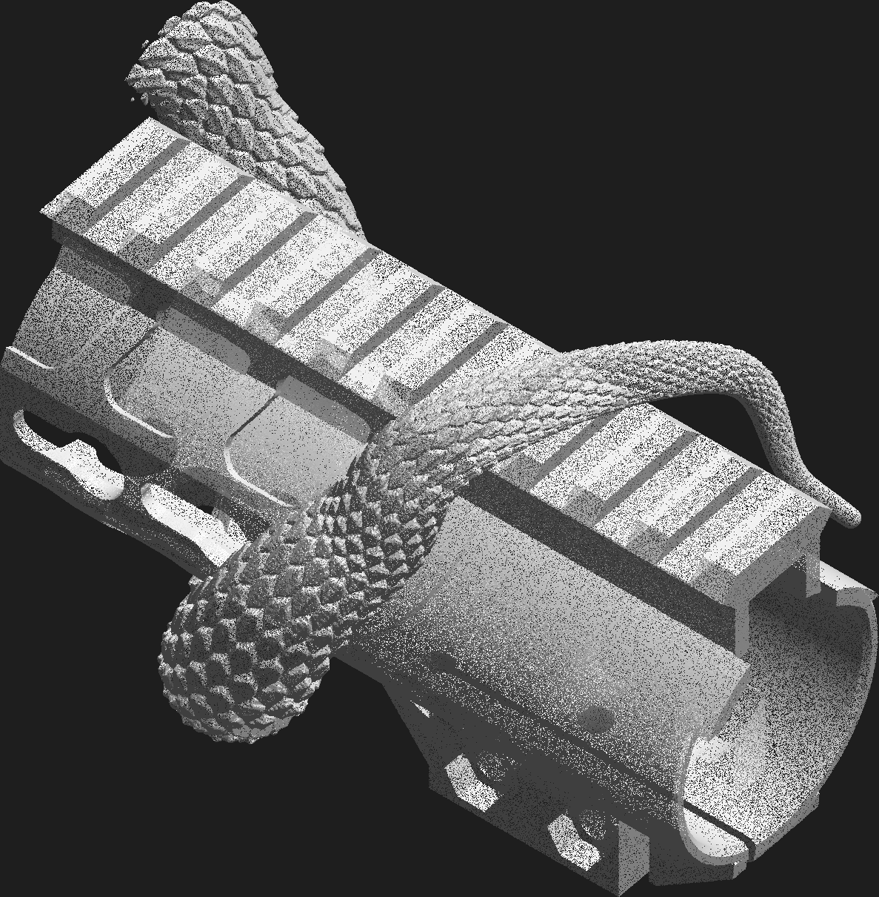
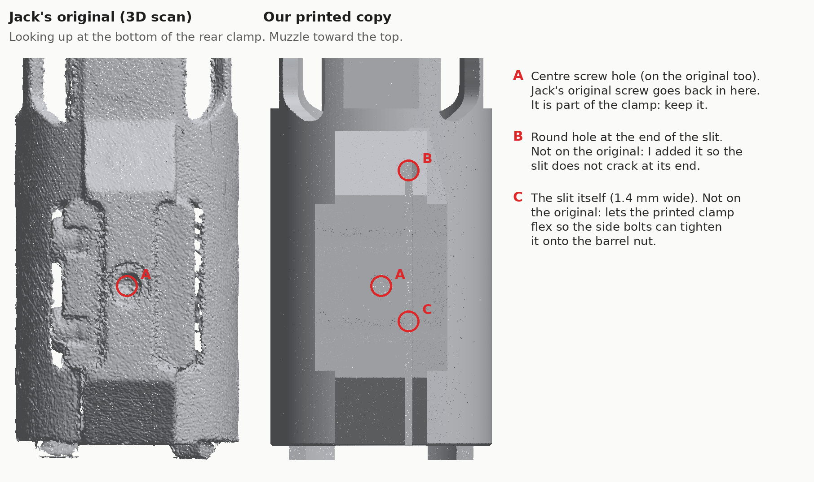

# Jack Beard's snake handguard (Trinity Force KMX-15)

Jack Beard sent us his **Trinity Force KMX-15 keymod free-float handguard**
(15 in, KM-34812-15) from a 16 in AR-15. He wants a printed copy with a viper coiled
around it, the snake concept he approved by text on 2026-10-17 ("lets do the snake first").
This folder rebuilds the handguard from the 3D scan as clean CAD, then sculpts the
snake as a separate part that slides on and off the handguard.


| file | what it is |
|---|---|
| [`handguard_base.stl`](handguard_base.stl) | **The handguard**, a copy of the original (387.2 mm long) |
| [`snake_rear.3mf`](snake_rear.3mf) | **Snake, rear piece**: tail and first coils, slides on first |
| [`snake_front.3mf`](snake_front.3mf) | **Snake, front piece**: coils and head, slides on second and locks with one set screw |
| [`handguard_fit_test.stl`](handguard_fit_test.stl) | The rear 70 mm of the handguard only (bore, lugs, clamp, rail start). **Print this first** to test the fit on the rifle. |

All files are in millimetres, with the bore axis along X (muzzle toward +X), the receiver end at X=0, the rail up (+Z) and the rifle's left side toward +Y.

## Measured from the scan

The scan (`Handguard_JackBeard.stl`, 12.2 M triangles) was taken with a front sight
and a bottom accessory rail still bolted on. The parts the gun touches were measured
directly. Repeated features (37 rail slots, 87 cut-outs) were averaged over every copy,
so scan noise cancels out.

| feature | value |
|---|---|
| length (lugs to muzzle end) | 387.2 mm |
| tube OD | 39.44 mm |
| barrel-nut bore, rear 60 mm | **34.6 mm** (scan 34.4 mm, plus 0.2 mm print clearance) |
| bore in front of the barrel nut | 32.6 mm |
| rail top above the bore axis | 31.1 mm |
| rail | MIL-STD-1913 profile, 37 slots at 10.0 mm pitch, first slot centre 10.7 mm from the rear |
| anti-rotation lugs | two arc tabs, 2.5 mm proud of the rear face, 26 to 56 deg either side of the rail |
| keymod | 15 per side at 20.0 mm pitch, 14 on the bottom, round hole at the muzzle end of each side |
| lightening slots | 2 rows per side, 17 each, 18.83 mm pitch |
| clamp | 2 cross bolts (M4 size, 7.2 mm heads), 1 bottom centre screw, bolt axes 22.3 mm below the bore |

Left off, as in the wheel-cap job: the laser-engraved T-numbers, the logo and the patent text.

## How well it matches

The distance from 334k scan points to the rebuilt model. A sampling error of about
0.05 mm is included.

| region | median | 95% |
|---|---|---|
| whole part | 0.17 mm | 0.68 mm |
| rear tube OD (slides into the receiver area) | 0.08 mm | 0.19 mm |
| barrel-nut bore (includes the deliberate +0.1 mm per side) | 0.18 mm | 0.48 mm |
| rail top | 0.17 mm | 0.33 mm |
| rail dovetail flanks | 0.27 mm | 0.76 mm |
| clamp block | 0.32 mm | 1.27 mm |


The red spots are not model errors:
- Edges of the cut-outs: the scanner rounds sharp edges.
- The clamp's screw pockets: the screws were still in the original.
- The front of the left side: a 0.2 mm residual tilt in the scan alignment.

The rail dovetail follows the MIL-STD-1913 drawing rather than the scan, because the
scanner smooths the undercut. Standard Picatinny accessories will fit it.

## The snake


- **Tail**: the spiral continues back past the rear clamp as a tail that tapers evenly
  over 117 mm to a 2.5 mm rounded tip just ahead of the receiver. Its scales shrink with it.
  It crosses over the rear rail and ends on the right side, clear of the clamp's bolts and slit.
- **Body**: one continuous spiral, 19 mm thick, four full turns from behind the rear
  clamp to the head. It crosses over the top rail and under the bottom on every
  turn, like the concept, with no breaks. It is covered in large keeled, overlapping scales
  (0.9 mm deep), sized to print cleanly with a 0.4 mm nozzle at 0.2 mm layers. At every angle
  it rests on the handguard's surface, and its belly is cut to the handguard's shape.
- **Head**: from **Meshy** (image-to-3D of Jack's concept picture,
  [`data/meshy_input_concept.jpg`](data/meshy_input_concept.jpg), task in
  [`data/meshy_task.json`](data/meshy_task.json)), with its brows, eyes, gaping jaws and fangs.
  It is scaled 0.300 mm per Meshy unit, centred on the bore axis, and blended into the end of
  the spiral. Two scaled jaw hinges hold the lower jaw, because the barrel passage cuts it at
  the middle. Meshy's own coils were not used: they stopped where they met the rail and the
  flat bottom.
- **Kept clear**: the 31 mm passage through the head for the barrel and muzzle device, the
  rear clamp (bolts, centre screw, slit) and the receiver end. Optics mount on the bare rail
  between the coils.





### Assembly

**Full illustrated guide: [renders/assembly_guide.png](renders/assembly_guide.png)**

Nothing snaps on. The handguard clamps onto the barrel nut like the original. The two snake
pieces slide on over the muzzle like sleeves and are held by one set screw.

The snake's inside is cut to the handguard's outer shape plus 0.35 mm clearance, with every
hole, slot and flat filled in. The spiral goes all the way around, so it cannot come off
sideways, and the flats and the rail stop it from turning. It only moves along the bore axis.

1. **Once, before the first fit**: press the M5 heat-set insert into the hole on top of the
   last coil of the front piece with a soldering iron (about 230 C for PA-CF/PC), flush.
2. Slide the **handguard** over the barrel onto the barrel nut, until the two tabs at its rear
   end sit against the receiver. Line its rail up with the receiver's rail.
3. Drop two **M4 hex nuts** into the hex pockets on the left side of the clamp. Put two
   **M4 x 25 bolts** in from the right with a drop of blue thread locker and tighten them a little
   at a time, alternating, to about 2 N m (firm, not cranked). Then put Jack's **centre screw**
   back in from below. Re-check the bolts after the first range trip.
4. Slide the **rear snake piece** on over the muzzle, tail first, until it stops against the
   step where the keymod flats begin, near the receiver.
5. Slide the **front piece** on behind it. The muzzle device passes through the head. Push it
   back until the head's inner wall sits against the handguard's muzzle end.
6. Tighten the **M5 set screw** into the insert. Its tip drops into the rail slot under the
   last coil, which locks the front piece. The front piece in turn holds the rear piece.

**To take the snake off**, loosen the set screw and slide both pieces forward off the muzzle.
The handguard stays on the rifle.

Hardware: one M5 x 12 set screw (cup or flat point) and one short M5 heat-set insert
(6.4 mm hole, 6 mm deep). The muzzle device must be under 31 mm in diameter to pass
through the head; an A2 flash hider or a 7/8 in brake fits.

## Printing (0.4 mm nozzle, 0.2 mm layers)

- **Size**: the handguard is 387.2 mm long, so it needs a big bed. It fits diagonally
  (about 40 deg) on a 350 x 320 mm bed such as the H2D, but not on a 256 mm bed. The two
  snake pieces are 209.7 mm and 251.8 mm long and fit a 256 mm bed.
- **Material**: **PA-CF (carbon-fibre nylon)** for all three parts. It is the strongest and stiffest
  common option and stays firm near a hot barrel. PC or PC-CF are next best. ASA works for the
  snake only. PLA and PETG will soften and creep: do not use them. Dry the PA-CF before printing,
  and use a hardened nozzle.
- **Orientation**: print the handguard **rail-down** (rail top flat on the bed, clamp block on top).
  The layers then run along the length and across the clamp bolts, its strongest direction for
  both bending and clamping. Use tree supports inside the bore and under the sides of the tube.
  Lay each snake piece on its side with tree supports.
- **Strength settings**: handguard 6 walls, 6 top and bottom layers, 50% gyroid (with walls
  this thin it prints almost solid). Snake pieces 4 walls, 25% gyroid.
- **Snake fit**: the 0.35 mm clearance assumes a calibrated printer. If a piece is tight,
  raise `CLEARANCE` in `scripts/build_snake.py`. If it rattles, lower it.
- **Clamp hardware**: the two cross-bolt holes are 4.5 mm clearance, with 7.6 mm counterbores on
  the right so the bolt heads sit flush, and hex pockets for M4 nuts on the left. The bolts
  pull on steel nuts, not plastic threads, so they cannot strip or work loose. The
  1.4 mm slit along the bottom of the clamp, open at the rear, lets the bolts squeeze the
  bore onto the barrel nut. The bottom centre screw hole is a 4.5 mm clearance hole with
  a counterbore for reusing the original screw.
  

  The 1.4 mm slit and the round hole at its end are not on Jack's original. They let the
  printed clamp flex so the side bolts can grip the barrel nut, and the round hole stops a
  crack from starting at the end of the slit.
- **Before the long print**: print `handguard_fit_test.stl`. Check that it slides onto the
  barrel nut, that the two rear lugs seat against the receiver, and that the rail lines up
  with the receiver rail. If the bore is tight, raise `R_BORE_REAR` in `scripts/build_handguard.py`.

**Things to confirm with Jack**:
- The muzzle device must fit through the 31 mm passage in the head, which leaves room
  for a standard A2 flash hider or a 7/8 in brake.
- A brake's side ports should sit in front of the jaws. The snout ends 65 mm past the handguard.
- If he uses a bipod on a keymod slot, it has to come off before the snake slides on.

## Strength

The original handguard is aluminium. A plastic copy needs more material in the right places to
hold up, so the printed parts differ from the original in a few hidden ways. None of them touch
the surfaces that fit the gun (rear tube, barrel-nut bore, rail): those still match the scan.

| change | why |
|---|---|
| lightening slots are 1.2 mm deep recesses, not holes | the tube stays a closed section instead of a cage of thin strips |
| 3.5 mm of plastic under each rail slot (was 1.5 mm) | optics and their clamps sit there and get shaken by recoil |
| steel M4 nuts in hex pockets, M4 x 25 bolts | plastic threads strip and loosen; the wider clamp boss leaves 4.6 mm of plastic behind each nut |
| 4.5 mm round end on the clamp slit (was 3.2 mm) | spreads the stress where a crack would start |
| snake joint square to the coil | the old flat cut ended in feather-thin wedges |
| solid 5 mm ring inside the head where it rests on the handguard | it takes the snake's weight every time the rifle cycles |
| thicker jaw hinges | they hold the lower jaw on |

Beam check of the handguard (`scripts/strength_check.py`). It slices the real model every
0.5 mm and loads it as a cantilever from the clamp. Material is printed PA-CF, 40 MPa in its
weakest direction:

| load | before | after |
|---|---|---|
| firing: the parts' own weight at 100 g of recoil, along the bore | 2.1 MPa | 1.4 MPa (safety factor about 30) |
| 200 N (20 kg) shove sideways at the muzzle end | 55 MPa, would crack | 33 MPa, safety factor 1.2 |
| 200 N vertical at the muzzle end | 37 MPa | 22 MPa |
| tip flex under the 200 N side shove | 16.9 mm | 12.8 mm |

Firing loads are tiny next to what the plastic can take. The heavy-abuse cases (leaning the
rifle's full weight on the muzzle end against a barricade, a hard knock) are where a printed
handguard is still weaker than aluminium.

## Rebuilding

```bash
pip install numpy scipy trimesh scikit-image matplotlib manifold3d shapely rtree pillow
bash handguard/scripts/get_inputs.sh                      # scan into handguard/work/ (gitignored)
cd handguard/work
python ../scripts/align_scan.py Handguard_JackBeard.stl --out tris_al.npy
python ../scripts/measure_templates.py tris_al.npy --out ../data/hole_templates.json
cd ../scripts
python build_handguard.py --out ../handguard_base.stl --fit-test ../handguard_fit_test.stl
MESHY_API_KEY=... python meshy_client.py submit snake_hg ../data/meshy_input_concept.jpg && MESHY_API_KEY=... python meshy_client.py wait snake_hg
python fit_meshy_snake.py        # about 7 min, writes snake_rear/front.3mf
python verify.py ../handguard_base.stl ../work/tris_al.npy --out ../verification/verification.json --fig ../verification/deviation_map.png
```

| script | does |
|---|---|
| `align_scan.py` | puts the scan in the model frame: PCA, bore axis from circle fits of the plain rear tube, and roll from the rail-top normals |
| `measure_templates.py` | unrolls the outer skin and averages every hole of each type into one outline (`data/hole_templates.json`) |
| `build_handguard.py` | CSG model (manifold3d): tube with keymod flats, Picatinny rail, hollow rail channel, lugs, clamp block, every cut-out at its measured pitch |
| `meshy_client.py` | submits the concept picture to Meshy and downloads the result (API key from `MESHY_API_KEY`, never stored) |
| `fit_meshy_snake.py` | builds the spiral body, fits Meshy's head, cuts the slide-on envelope, barrel passage and lock screw, splits into two pieces |
| `build_snake.py` | the shared fit constants and envelope; also the earlier hand-modelled snake (no longer used for the print files) |
| `verify.py` | scan-to-model distances, with the bolted-on accessories masked out |
| `strength_check.py` | beam analysis of the handguard from its real cross-sections (`verification/strength.json`) |
| `thin_check.py` | finds features thinner than 2 mm (5 nozzle widths) in any printed part |
| `render_util.py` | the preview renders in `renders/` |
| `assembly_guide.py` | the illustrated fitting and removal guide (`renders/assembly_guide.png`) |
