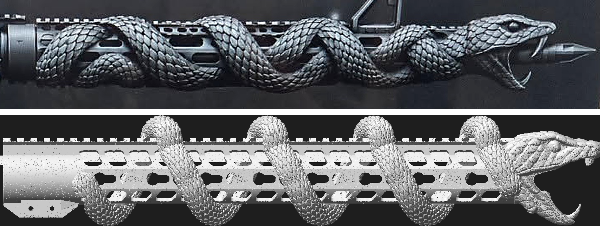
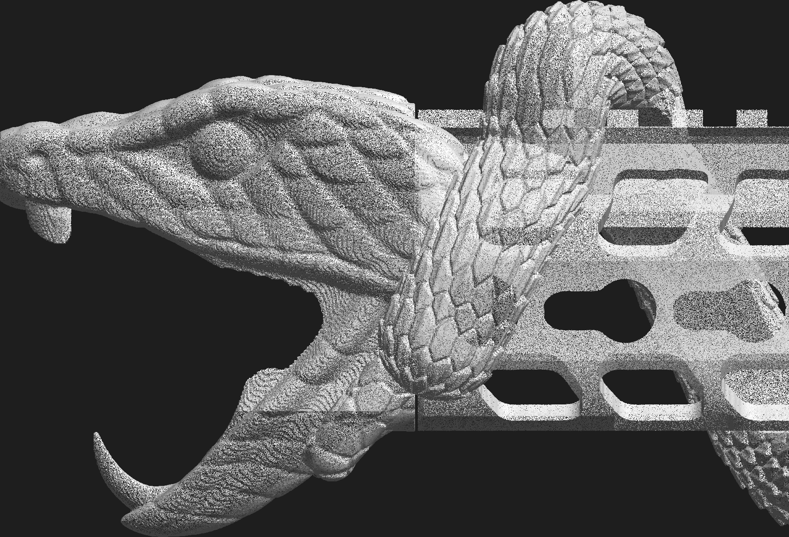
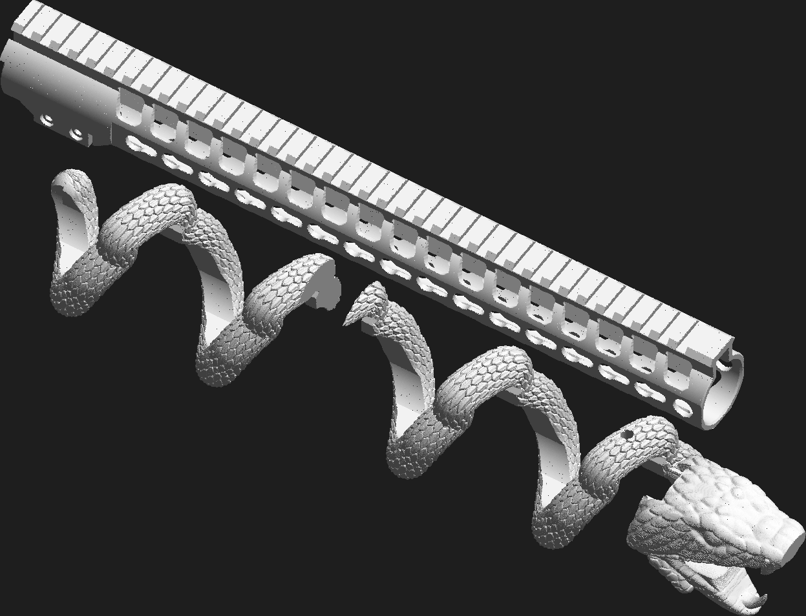

# Jack Beard's snake handguard (Trinity Force KMX-15)

Jack Beard sent us his **Trinity Force KMX-15 keymod free-float handguard**
(15 in, KM-34812-15) from a 16 in AR-15. He wants a printed copy with a viper coiled
around it, the snake concept he approved by text on 2026-10-17 ("lets do the snake first").
This folder rebuilds the handguard from the 3D scan as clean CAD, then sculpts the
snake as a separate part that slides on and off the handguard.


| file | what it is |
|---|---|
| [`handguard_base.stl`](handguard_base.stl) | **The handguard**, a copy of the original (387.2 mm long) |
| [`snake_rear.3mf`](snake_rear.3mf) | **Snake, rear piece**: tail and first coils, slides on first |
| [`snake_front.3mf`](snake_front.3mf) | **Snake, front piece**: coils and head, slides on second and locks with one set screw |
| [`handguard_fit_test.stl`](handguard_fit_test.stl) | The rear 70 mm of the handguard only (bore, lugs, clamp, rail start). **Print this first** to test the fit on the rifle. |

All files are in millimetres, with the bore axis along X (muzzle toward +X), the receiver end at X=0, the rail up (+Z) and the rifle's left side toward +Y.

## Measured from the scan

The scan (`Handguard_JackBeard.stl`, 12.2 M triangles) was taken with a front sight
and a bottom accessory rail still bolted on. The parts the gun touches were measured
directly. Repeated features (37 rail slots, 87 cut-outs) were averaged over every copy,
so scan noise cancels out.

| feature | value |
|---|---|
| length (lugs to muzzle end) | 387.2 mm |
| tube OD | 39.44 mm |
| barrel-nut bore, rear 60 mm | **34.6 mm** (scan 34.4 mm, plus 0.2 mm print clearance) |
| bore in front of the barrel nut | 32.6 mm |
| rail top above the bore axis | 31.1 mm |
| rail | MIL-STD-1913 profile, 37 slots at 10.0 mm pitch, first slot centre 10.7 mm from the rear |
| anti-rotation lugs | two arc tabs, 2.5 mm proud of the rear face, 26 to 56 deg either side of the rail |
| keymod | 15 per side at 20.0 mm pitch, 14 on the bottom, round hole at the muzzle end of each side |
| lightening slots | 2 rows per side, 17 each, 18.83 mm pitch |
| clamp | 2 cross bolts (M4 size, 7.2 mm heads), 1 bottom centre screw, bolt axes 22.3 mm below the bore |

Left off, as in the wheel-cap job: the laser-engraved T-numbers, the logo and the patent text.

## How well it matches

The distance from 334k scan points to the rebuilt model. A sampling error of about
0.05 mm is included.

| region | median | 95% |
|---|---|---|
| whole part | 0.17 mm | 0.68 mm |
| rear tube OD (slides into the receiver area) | 0.08 mm | 0.19 mm |
| barrel-nut bore (includes the deliberate +0.1 mm per side) | 0.18 mm | 0.48 mm |
| rail top | 0.17 mm | 0.33 mm |
| rail dovetail flanks | 0.27 mm | 0.76 mm |
| clamp block | 0.32 mm | 1.27 mm |


The red spots are not model errors:
- Edges of the cut-outs: the scanner rounds sharp edges.
- The clamp's screw pockets: the screws were still in the original.
- The front of the left side: a 0.2 mm residual tilt in the scan alignment.

The rail dovetail follows the MIL-STD-1913 drawing rather than the scan, because the
scanner smooths the undercut. Standard Picatinny accessories will fit it.

## The snake



- **Body**: one continuous spiral, 19 mm thick, four full turns from behind the rear
  clamp to the head. It crosses over the top rail and under the bottom on every
  turn, like the concept, with no breaks. It is covered in large keeled, overlapping scales
  (0.9 mm deep), sized to print cleanly with a 0.4 mm nozzle at 0.2 mm layers. At every angle
  it rests on the handguard's surface, and its belly is cut to the handguard's shape.
- **Head**: from **Meshy** (image-to-3D of Jack's concept picture,
  [`data/meshy_input_concept.jpg`](data/meshy_input_concept.jpg), task in
  [`data/meshy_task.json`](data/meshy_task.json)), with its brows, eyes, gaping jaws and fangs.
  It is scaled 0.300 mm per Meshy unit, centred on the bore axis, and blended into the end of
  the spiral. Two scaled jaw hinges hold the lower jaw, because the barrel passage cuts it at
  the middle. Meshy's own coils were not used: they stopped where they met the rail and the
  flat bottom.
- **Kept clear**: the 31 mm passage through the head for the barrel and muzzle device, the
  rear clamp (bolts, centre screw, slit) and the receiver end. Optics mount on the bare rail
  between the coils.




### Taking the snake on and off

**Step-by-step picture: [renders/assembly_guide.png](renders/assembly_guide.png)**

The snake does not touch the handguard's fit to the gun. Its inside is cut to the
handguard's outer shape plus 0.35 mm clearance, with every hole, slot and flat filled in.
It wraps about 230 deg around, so it cannot lift off, and the flats and the rail stop it
from turning. It only moves along the bore axis, and slides over the muzzle end like a sleeve.



**To fit it** (with the handguard on the rifle, and anything on the keymod slots removed):
1. Slide the **rear piece** on over the muzzle, tail first, until it stops against the
   step where the keymod flats begin, near the receiver.
2. Slide the **front piece** on behind it. The muzzle device passes through the head.
   Push it back until the head's inner wall sits against the handguard's muzzle end. The
   two pieces then meet at their joint.
3. Tighten the **M5 set screw** in the last coil, where it crosses the rail. It goes through a
   heat-set insert and into the rail slot under the coil, which locks the front piece. The front
   piece in turn holds the rear piece.

**To take it off**, loosen the set screw and slide both pieces forward off the muzzle.

Hardware: one M5 x 12 set screw (cup or flat point) and one short M5 heat-set insert
(6.4 mm hole, 6 mm deep). The muzzle device must be under 31 mm in diameter to pass
through the head; an A2 flash hider or a 7/8 in brake fits.

## Printing (0.4 mm nozzle, 0.2 mm layers)

- **Size**: the handguard is 387.2 mm long, so it needs a big bed. It fits diagonally
  (about 40 deg) on a 350 x 320 mm bed such as the H2D, but not on a 256 mm bed. The two
  snake pieces are 155.1 mm and 242.7 mm long and fit a 256 mm bed.
- **Material**: the handguard sits around a hot barrel. PLA and PETG will soften. Use
  PA-CF, PET-CF, ASA or PC. With carbon-fibre filament, use a hardened nozzle.
- **Orientation**: lay the handguard on its right side (the side with the cross-bolt heads),
  with supports only under the clamp block. Lay each snake piece on its right side too, with
  tree supports. Use 4+ walls on the handguard and about 30% gyroid infill. The snake can
  use fewer walls.
- **Snake fit**: the 0.35 mm clearance assumes a calibrated printer. If a piece is tight,
  raise `CLEARANCE` in `scripts/build_snake.py`. If it rattles, lower it.
- **Clamp hardware**: the two cross-bolt holes are 4.5 mm clearance on the screw-head
  side (7.6 mm counterbores) and 3.4 mm pilot holes on the other side. Tap M4 (or #8-32
  if Jack's original screws are imperial), or open them up for heat-set inserts. The
  1.4 mm slit along the bottom of the clamp, open at the rear, lets the bolts squeeze the
  bore onto the barrel nut. The bottom centre screw hole is a 4.5 mm clearance hole with
  a counterbore for reusing the original screw.
- **Before the long print**: print `handguard_fit_test.stl`. Check that it slides onto the
  barrel nut, that the two rear lugs seat against the receiver, and that the rail lines up
  with the receiver rail. If the bore is tight, raise `R_BORE_REAR` in `scripts/build_handguard.py`.

**Things to confirm with Jack**:
- The muzzle device must fit through the 31 mm passage in the head, which leaves room
  for a standard A2 flash hider or a 7/8 in brake.
- A brake's side ports should sit in front of the jaws. The snout ends 51 mm past the handguard.
- If he uses a bipod on a keymod slot, it has to come off before the snake slides on.

## Rebuilding

```bash
pip install numpy scipy trimesh scikit-image matplotlib manifold3d shapely rtree pillow
bash handguard/scripts/get_inputs.sh                      # scan into handguard/work/ (gitignored)
cd handguard/work
python ../scripts/align_scan.py Handguard_JackBeard.stl --out tris_al.npy
python ../scripts/measure_templates.py tris_al.npy --out ../data/hole_templates.json
cd ../scripts
python build_handguard.py --out ../handguard_base.stl --fit-test ../handguard_fit_test.stl
MESHY_API_KEY=... python meshy_client.py submit snake_hg ../data/meshy_input_concept.jpg && MESHY_API_KEY=... python meshy_client.py wait snake_hg
python fit_meshy_snake.py        # about 7 min, writes snake_rear/front.3mf
python verify.py ../handguard_base.stl ../work/tris_al.npy --out ../verification/verification.json --fig ../verification/deviation_map.png
```

| script | does |
|---|---|
| `align_scan.py` | puts the scan in the model frame: PCA, bore axis from circle fits of the plain rear tube, and roll from the rail-top normals |
| `measure_templates.py` | unrolls the outer skin and averages every hole of each type into one outline (`data/hole_templates.json`) |
| `build_handguard.py` | CSG model (manifold3d): tube with keymod flats, Picatinny rail, hollow rail channel, lugs, clamp block, every cut-out at its measured pitch |
| `meshy_client.py` | submits the concept picture to Meshy and downloads the result (API key from `MESHY_API_KEY`, never stored) |
| `fit_meshy_snake.py` | builds the spiral body, fits Meshy's head, cuts the slide-on envelope, barrel passage and lock screw, splits into two pieces |
| `build_snake.py` | the shared fit constants and envelope; also the earlier hand-modelled snake (no longer used for the print files) |
| `verify.py` | scan-to-model distances, with the bolted-on accessories masked out |
| `render_util.py` | the preview renders in `renders/` |
| `assembly_guide.py` | the illustrated fitting and removal guide (`renders/assembly_guide.png`) |
