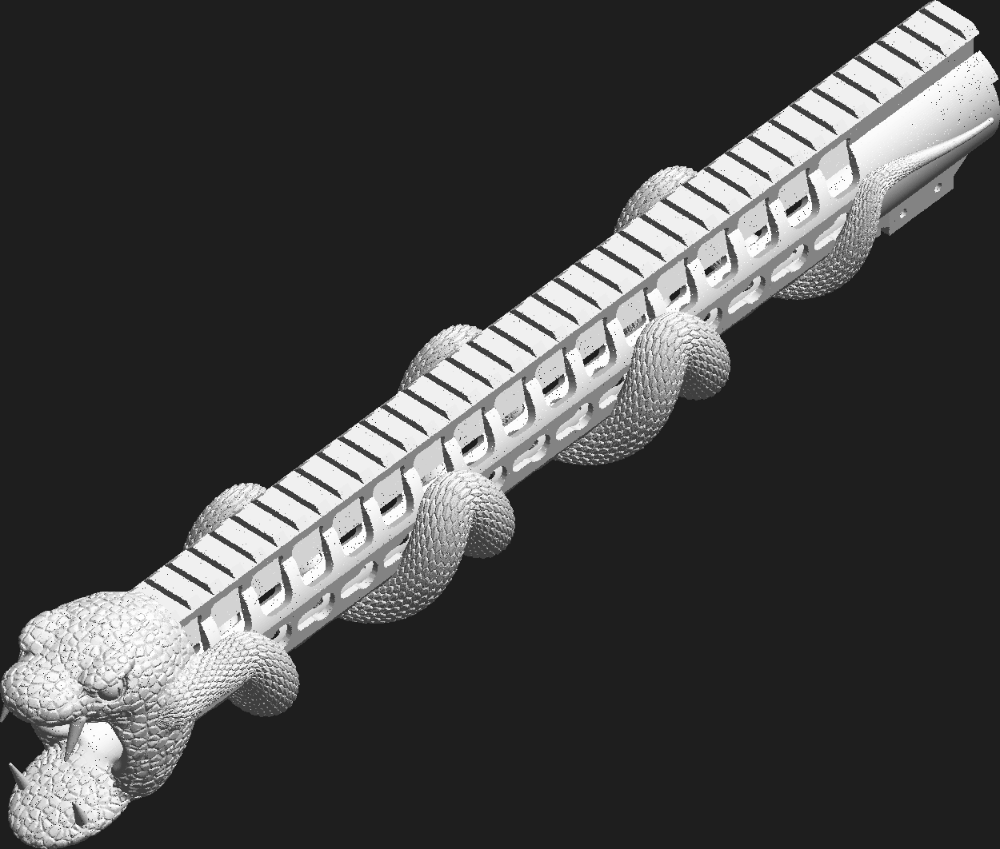
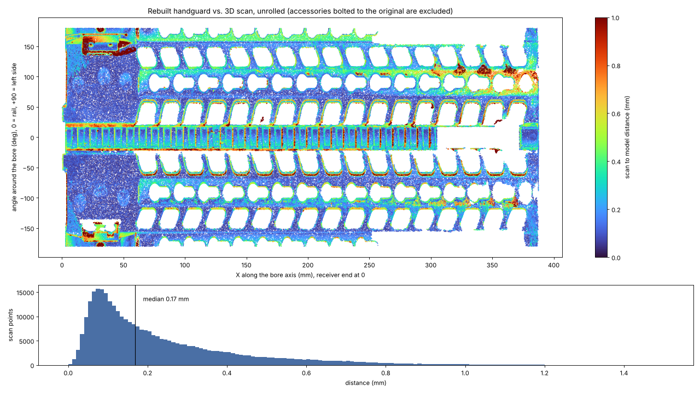
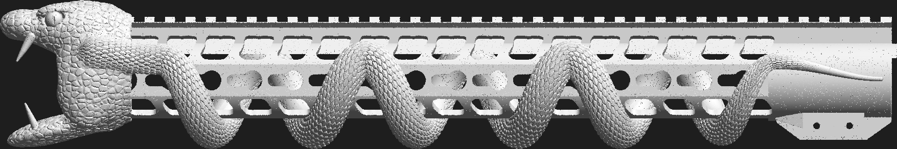
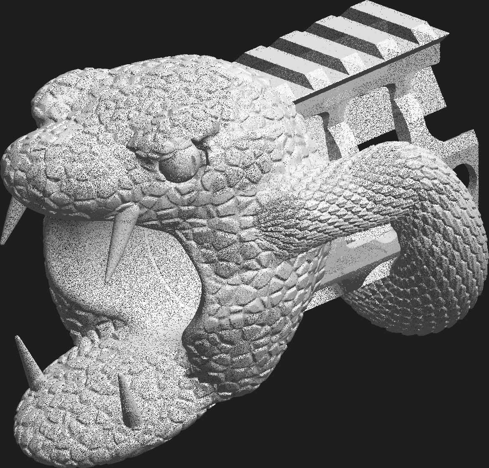

# Jack Beard's snake handguard (Trinity Force KMX-15)

Jack Beard sent us his **Trinity Force KMX-15 keymod free-float handguard**
(15 in, KM-34812-15) from a 16 in AR-15. He wants a printed copy with a viper coiled
around it, the snake concept he approved by text on 2026-10-17 ("lets do the snake first").
This folder rebuilds the handguard from the 3D scan as clean CAD, then sculpts the
snake onto it.



| file | what it is |
|---|---|
| [`handguard_snake.3mf`](handguard_snake.3mf) | **The finished part**, one piece (438.8 mm long) |
| [`handguard_snake_rear.3mf`](handguard_snake_rear.3mf), [`handguard_snake_front.3mf`](handguard_snake_front.3mf) | The same part in two pieces with dowel-pin holes, for beds smaller than about 450 mm |
| [`handguard_fit_test.stl`](handguard_fit_test.stl) | The rear 70 mm only (bore, lugs, clamp, rail start). **Print this first** to test the fit on the rifle. |
| [`handguard_base.stl`](handguard_base.stl) | The plain handguard without the snake |

All files are in millimetres, with the bore axis along X (muzzle toward +X), the receiver end at X=0, the rail up (+Z) and the rifle's left side toward +Y.

## Measured from the scan

The scan (`Handguard_JackBeard.stl`, 12.2 M triangles) was taken with a front sight
and a bottom accessory rail still bolted on. The parts the gun touches were measured
directly. Repeated features (37 rail slots, 87 cut-outs) were averaged over every copy,
so scan noise cancels out.

| feature | value |
|---|---|
| length (lugs to muzzle end) | 387.2 mm |
| tube OD | 39.44 mm |
| barrel-nut bore, rear 60 mm | **34.6 mm** (scan 34.4 mm, plus 0.2 mm print clearance) |
| bore in front of the barrel nut | 32.6 mm |
| rail top above the bore axis | 31.1 mm |
| rail | MIL-STD-1913 profile, 37 slots at 10.0 mm pitch, first slot centre 10.7 mm from the rear |
| anti-rotation lugs | two arc tabs, 2.5 mm proud of the rear face, 26 to 56 deg either side of the rail |
| keymod | 15 per side at 20.0 mm pitch, 14 on the bottom, round hole at the muzzle end of each side |
| lightening slots | 2 rows per side, 17 each, 18.83 mm pitch |
| clamp | 2 cross bolts (M4 size, 7.2 mm heads), 1 bottom centre screw, bolt axes 22.3 mm below the bore |

Left off, as in the wheel-cap job: the laser-engraved T-numbers, the logo and the patent text.

## How well it matches

The distance from 334k scan points to the rebuilt model. A sampling error of about
0.05 mm is included.

| region | median | 95% |
|---|---|---|
| whole part | 0.17 mm | 0.68 mm |
| rear tube OD (slides into the receiver area) | 0.08 mm | 0.19 mm |
| barrel-nut bore (includes the deliberate +0.1 mm per side) | 0.18 mm | 0.48 mm |
| rail top | 0.17 mm | 0.33 mm |
| rail dovetail flanks | 0.27 mm | 0.76 mm |
| clamp block | 0.32 mm | 1.27 mm |



The red spots are not model errors:
- Edges of the cut-outs: the scanner rounds sharp edges.
- The clamp's screw pockets: the screws were still in the original.
- The front of the left side: a 0.2 mm residual tilt in the scan alignment.

The rail dovetail follows the MIL-STD-1913 drawing rather than the scan, because the
scanner smooths the undercut. Standard Picatinny accessories will fit it.

## The snake

Taken from the concept image Jack approved (coiled viper, keeled scales, open
mouth with fangs at the muzzle):

- **Body**: 17 mm thick and covered in keeled, overlapping diamond scales (0.55 mm deep,
  2.7 mm rows), so the scales print cleanly with a 0.4 mm nozzle at 0.2 mm layers. It starts as a
  thin tail along the left side of the rear tube, then wraps under the handguard six
  times, climbing to 65 deg either side of the rail, and runs up the left side as the neck.
- **Head**: a viper head on the muzzle end with brow ridges, slit-pupil eyes, nostrils,
  scaled skin, a wide-open mouth, two upper and two lower fangs. It reaches 51 mm past the
  end of the handguard.
- **Kept clear**: the whole Picatinny rail and the space above and beside it, so sights and
  optics still mount. Also kept clear: the bore, a 31 mm-diameter passage straight through the head for the
  barrel and muzzle device, the rear clamp (bolts, centre screw, slit) and the receiver end.
  The fangs stay outside that passage.




**Different from the concept**: the concept's coils also cross over the top of the rail.
Here the body turns back at 65 deg so the rail stays usable. Some keymod slots on the
sides and bottom are covered by the body, which is the cost of the coils.

## Printing (0.4 mm nozzle, 0.2 mm layers)

- **Size**: one piece is 438.8 x 67.4 x 72.9 mm. It does not fit a 256 mm bed (X1/P1/A1) or
  a 350 x 320 mm bed (H2D), even diagonally. Use the two-piece files on those: rear
  209.2 mm, front 229.4 mm. Join them at X=209.4 with three 3 mm dowel pins (holes are
  3.2 x 6 mm deep on each side, placed in the snake body where it runs parallel to the
  bore) and a structural epoxy. Clamp the two halves rail-down on a straight edge while
  the glue cures, so the rail stays straight.
- **Material**: the handguard sits around a hot barrel. PLA and PETG will soften. Use
  PA-CF, PET-CF, ASA or PC. With carbon-fibre filament, use a hardened nozzle.
- **Orientation**: lay it on its right side (the side with the cross-bolt heads, which puts the snake's tail and neck on top)
  with tree supports for the coils and the head. Use 4+ walls and about 30% gyroid infill for stiffness.
- **Clamp hardware**: the two cross-bolt holes are 4.5 mm clearance on the screw-head
  side (7.6 mm counterbores) and 3.4 mm pilot holes on the other side. Tap M4 (or #8-32
  if Jack's original screws are imperial), or open them up for heat-set inserts. The
  1.4 mm slit along the bottom of the clamp, open at the rear, lets the bolts squeeze the
  bore onto the barrel nut. The bottom centre screw hole is a 4.5 mm clearance hole with
  a counterbore for reusing the original screw.
- **Before the long print**: print `handguard_fit_test.stl`. Check that it slides onto the
  barrel nut, that the two rear lugs seat against the receiver, and that the rail lines up
  with the receiver rail. If the bore is tight, raise `R_BORE_REAR` in `scripts/build_handguard.py`.

**Things to confirm with Jack**:
- The muzzle device must fit through the 31 mm passage in the head, which leaves room
  for a standard A2 flash hider or a 7/8 in brake.
- A brake's side ports should sit in front of the jaws. The snout ends 51 mm past the handguard.
- If he uses a bipod, it needs a keymod slot that the body leaves free, or the front
  picatinny section of the rail.

## Rebuilding

```bash
pip install numpy scipy trimesh scikit-image matplotlib manifold3d shapely rtree pillow
bash handguard/scripts/get_inputs.sh                      # scan into handguard/work/ (gitignored)
cd handguard/work
python ../scripts/align_scan.py Handguard_JackBeard.stl --out tris_al.npy
python ../scripts/measure_templates.py tris_al.npy --out ../data/hole_templates.json
cd ../scripts
python build_handguard.py --out ../handguard_base.stl --fit-test ../handguard_fit_test.stl
python build_snake.py --cache ../work/snake_raw.npz   # about 9 min the first time, writes the .3mf files
python verify.py ../handguard_base.stl ../work/tris_al.npy --out ../verification/verification.json --fig ../verification/deviation_map.png
```

| script | does |
|---|---|
| `align_scan.py` | puts the scan in the model frame: PCA, bore axis from circle fits of the plain rear tube, and roll from the rail-top normals |
| `measure_templates.py` | unrolls the outer skin and averages every hole of each type into one outline (`data/hole_templates.json`) |
| `build_handguard.py` | CSG model (manifold3d): tube with keymod flats, Picatinny rail, hollow rail channel, lugs, clamp block, every cut-out at its measured pitch |
| `build_snake.py` | signed-distance snake (body, scales, head), marching cubes at 0.25 mm, union with the handguard, two-piece split with pin holes |
| `verify.py` | scan-to-model distances, with the bolted-on accessories masked out |
| `render_util.py` | the preview renders in `renders/` |
