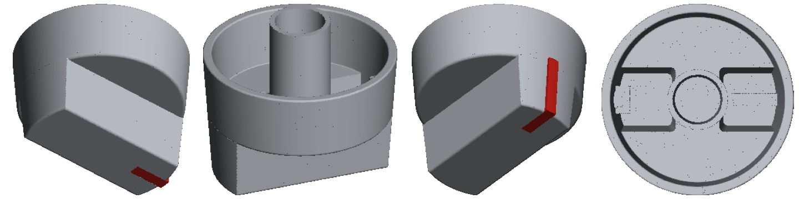
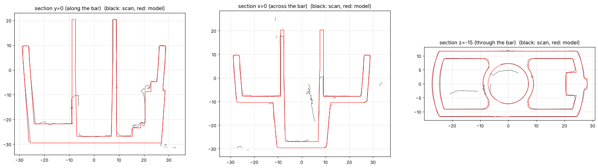
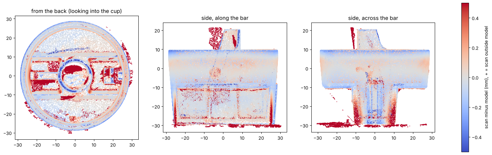

# Chrome bar knob (mold mark 1439/A)

A printable replacement for the chrome bar knob with the + / - markings. The model is
built from dimensions measured on the 3D scan (`Mesh_Knob Scan.stl`) and checked
against it.



## Files

| file | what it is |
|---|---|
| [`knob.stl`](knob.stl) | the whole knob as one body (pointer included), for single-color printing |
| [`knob_body.stl`](knob_body.stl) + [`knob_pointer.stl`](knob_pointer.stl) | the same knob split in two, so the pointer can print red |
| [`knob_2color.3mf`](knob_2color.3mf) | body and pointer in one file, ready to assign two filaments |

All files are in millimeters, already in print orientation: the bar's front face is on
z=0 and the open cup faces up.

## Measured from the scan

| feature | value |
|---|---|
| skirt diameter | 57.8 mm at the back rim, 54.9 mm at the front disc (4.1 deg draft) |
| skirt wall | 2.6 mm |
| overall height | 49.95 mm (bar front to the back end of the shaft sleeve) |
| skirt height | 20.1 mm (front disc to back rim) |
| grip bar | 20.8 mm wide at the front, 24.3 mm where it meets the disc (5.2 deg draft), 19.1 mm tall; its ends follow the skirt |
| bar pockets | two, open from the back, 2.6 mm walls, 2.75 mm front wall |
| shaft sleeve | 18.0 mm outside, bore 13.9 mm at the bottom widening to 15.1 mm, 47.3 mm deep, sticks out 10.75 mm past the rim |
| pointer | 3.8 mm wide, stands 0.96 mm proud of the bar's end face |

## How it was measured

1. The knob was cut out of the scan and the turntable planes removed.
2. The axis comes from fitting the skirt's inner and outer walls as two coaxial cones.
   A plain cylinder fit tilted the axis by 4.7 deg. The skirt has a 4.1 deg molding
   draft, and with the cone fit the back rim comes out flat to within 0.1 mm all the way
   around, which confirms the axis.
3. Each feature was measured on cross sections in that frame: the bar and pocket walls
   (both drafted), the cup floor, the pocket bottoms, the sleeve and bore, the ribs and
   the pointer.
4. `scripts/build_knob.py` builds the knob from those numbers as exact solids
   (manifold3d), so walls are flat and true, without scan noise.

## Accuracy

The model matches the scan surface to **0.06 mm median**; 83% of the scan lies within
0.2 mm of the model and 92% within 0.5 mm. Per feature, the median offset between scan
and model is under 0.06 mm everywhere:

| feature | median offset | feature | median offset |
|---|---|---|---|
| skirt outside | 0.00 mm | bar sides | -0.02 mm |
| skirt inside | 0.00 mm | bar ends | +0.01 mm |
| back rim | -0.02 mm | pocket walls | 0.00 mm |
| cup floor | -0.02 mm | sleeve outside | 0.00 mm |
| front disc | +0.06 mm | bore | +0.01 mm |

The larger deviations in the statistics come from places where the model is deliberately
different from the scan:

- **Broken sleeve.** About half of the shaft sleeve's wall above the cup floor has broken
  off the original knob (the photos show the jagged edge). The model has the full sleeve.
- **Black insert in the bore.** A separate black part sits inside the sleeve; the scanner
  only caught bits of it. The model has the knob's own bore (13.9 to 15.1 mm), so the
  insert from the old knob moves over to the new one.
- **Front faces.** The knob was scanned lying on its face, so the bar's front face and
  the front disc faces were not captured. Their heights come from the walls around them
  and from where the knob sat on the turntable.
- **Pointer.** On the original, the red strip on the bar's front face appears to stand
  about 1 mm proud. The model keeps it flush (inlaid 1 mm deep) so the knob prints flat
  on its face; the pointer on the end face stands proud as on the original.

Small cosmetic details were left out: the 1439/A and "4" mold marks, ejector pin marks,
and the 0.1-0.3 mm fillets inside the pockets.





## Printing (0.4 mm nozzle, 0.08 mm layers)

- **Orientation:** as exported, bar face down. The pockets and the cup open upward, and
  the drafted walls lean outward by only 4-5 deg, so they print without supports.
- **Supports:** only under the two half-moon faces on either side of the bar (19 mm
  above the bed). Use tree supports, build plate only.
- **Walls:** the thinnest wall is the sleeve at 1.44 mm near its top end, so 2-3
  perimeters print every wall solid.
- **Two colors:** open `knob_2color.3mf` (or load `knob_body.stl` and add
  `knob_pointer.stl` as a part), then assign red to the pointer.
- **Bore fit:** printed holes usually come out 0.1-0.2 mm small. Test-fit the black
  insert. If it is too tight, use the slicer's X-Y hole compensation (about +0.1 mm).
- **Material:** PETG or ASA if the appliance gets warm. Silver silk PLA comes closest
  to the chrome look.

## Rebuilding

```bash
pip install numpy scipy trimesh manifold3d matplotlib
cd knob
python scripts/build_knob.py --outdir . --scan-frame && mv knob_scanframe.stl work/
# verification needs the scan (not in the repo):
python scripts/align_scan.py "Mesh_Knob Scan.stl" work/scan_aligned.ply
python scripts/verify_knob.py work/knob_scanframe.stl work/scan_aligned.ply --outdir verification
```

Every dimension is a named constant at the top of `scripts/build_knob.py`, so the bore
or any other feature can be changed and the model rebuilt.
