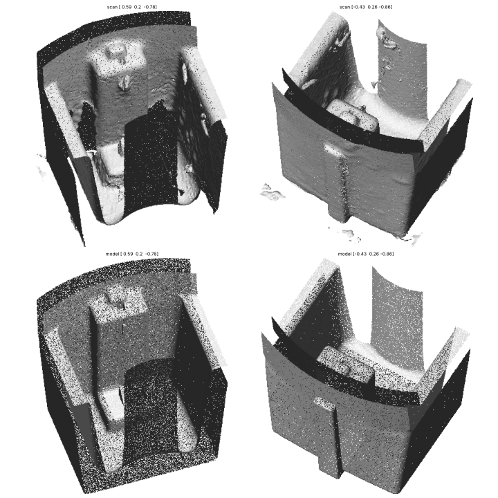
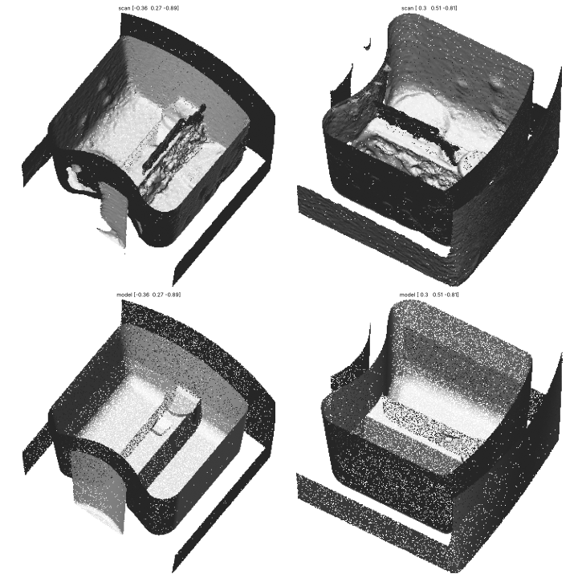

# Chrome bar knob (mold mark 1439/A)

A printable replacement for the chrome bar knob with the + / - markings. The model is
built from dimensions measured on the 3D scan (`Mesh_Knob Scan.stl`) and checked
against it.


## Files

| file | what it is |
|---|---|
| [`knob_body.stl`](knob_body.stl) | the knob without the pointer, to print: front face down, cup up |
| [`knob_pointer.stl`](knob_pointer.stl) | the raised red pointer strip, to print in red lying on its side and glue on; two small square pins locate it |
| [`knob.stl`](knob.stl) | the assembled knob as one body, for viewing and checking |

All files are in millimeters. Like the original, the pointer is a separate piece: it
stands about 1 mm proud of the bar's end and front faces, so printing it as part of the
body would lift the front face off the bed.

## Measured from the scan

| feature | value |
|---|---|
| skirt diameter | 57.3 mm across the straight band near the back rim (from about 5.5 mm below the rim), tapering about 5 deg to 54.6 mm at the front disc |
| skirt wall | 2.6 mm |
| overall height | 49.95 mm (bar front to the back end of the shaft sleeve) |
| skirt height | 20.1 mm (front disc to back rim) |
| grip bar | 20.8 mm wide at the front, 24.3 mm where it meets the disc (5.2 deg draft), 19.1 mm tall |
| bar ends | curved in plan: nearly flat at the bar's front face (about 100 mm radius), getting rounder toward the disc, where they blend smoothly into the skirt (about 27 mm radius); 51.2 mm long at the front |
| bar pockets | two, open from the back; 2.6 mm side walls, 2.67 mm end walls (curved like the bar ends), 2.75 mm front wall |
| shaft sleeve | 18.0 mm outside, bore 13.9 mm at the bottom widening to 15.1 mm, 47.3 mm deep, sticks out 10.75 mm past the rim |
| pointer | raised L-shaped strip, 3.2 mm wide, 1.0 mm proud on the front face (7.1 mm long there), 1.07 to 1.35 mm thick down the end face |
| pointer block | inside the pointer end of the bar: a lower step (top 3.55 mm above the pocket bottom) and a tall block whose top stands 1.6 mm above the cup floor, with a 2.5 mm wide tip against the skirt and a 1.1 x 1.1 mm recess in the block's top, running up to the tip's face, where an insert prong comes through |
| insert features | where the original red insert's prongs show inside the block: a wedge on the lower step that ramps up 1.85 mm and ends in a straight cut (trapezoid profile, 1.9 mm wide), and a narrow flat pad, 0.45 mm wide, 2.3 mm tall and 0.35 mm proud, on the tall block's face |
| rib | along the bottom of the left pocket, 3.2 mm wide at the top and slightly wider at its base, 4.95 mm tall, sharp edged like the original; at the wall end a 3.8 mm round boss, centred on the rib and just touching the pocket's end wall, whose top slopes from 5.8 mm above the pocket bottom down toward the skirt; next to it a 0.5 mm deep dip in the rib's top, a trapezoid in plan (2.0 mm wide at the boss end, 1.3 mm at the far end) with a gentle ramp on the boss side and a steeper rise at the far end |

## How it was measured

1. The knob was cut out of the scan and the turntable planes removed.
2. The axis comes from fitting the skirt's inner and outer walls as two coaxial cones.
   A plain cylinder fit tilted the axis by 4.7 deg because the skirt has molding draft;
   with the cone fit the back rim comes out flat to within 0.1 mm all the way around,
   which confirms the axis.
3. In that frame every surface was measured on the scan: the skirt's wall profile (it
   is not one cone: about 5 deg of draft low down, curving into a straight band near the
   rim), the bar and pocket walls (both drafted), the curved bar and pocket ends, the cup
   floor, the pocket bottoms, the sleeve and bore, the blocks and the rib,
   and the pointer.
4. `scripts/build_knob.py` builds the knob from those numbers as exact solids (revolved
   wall profiles following a smooth spline through the measured points, drafted slabs, curved end surfaces, planes, cylinders, boxes) joined
   with rounded booleans, which give true circular fillets and edge rounds where faces
   meet. The result is meshed at 0.08 mm, so walls are flat and true, without scan noise.
5. The model was then laid over the scan and every place where they disagree by more
   than 0.3 mm was examined and fixed, until only the deliberate differences listed
   under Accuracy were left.

## Fillets and rounds

| where | radius |
|---|---|
| pocket corners next to the sleeve | 2.5 mm |
| sleeve to the pocket bottoms | 2.0 mm |
| pocket bottoms | 1.5 mm |
| pocket corners at the skirt end | 1.0 mm |
| sleeve to the cup floor and up the pocket ends | 1.0 mm |
| bar sides to the front disc | 1.0 mm |
| skirt to the disc front face, bar ends to the bar front, bar sides to bar ends | 0.8 mm |
| bar sides to the bar front | 0.8 mm |
| blocks to the pocket faces and skirt wall | 0.8 mm |
| block edges | 0.6 mm |
| pocket openings in the cup floor | 0.5 mm |
| bore bottom | 0.5 mm |
| back rim | 0.65 mm outer edge, 0.6 mm inner edge |
| cup floor to skirt wall | 0.4 mm |
| sleeve end, both edges | 0.4 mm |
| pointer edges | 0.3 mm, 1.0 mm outer radius over the bend |

The rib with its end boss and dip in the left pocket, the wedge, the pad and the square recess
keep sharp edges, as on the original.

## Accuracy

The model matches the scan surface to **0.03 mm median**; 89% of the scan lies within
0.2 mm of the model and 93% within 0.5 mm. Per feature, the median offset between scan
and model:

| feature | median offset | feature | median offset |
|---|---|---|---|
| skirt outside | 0.00 mm | bar sides | -0.03 mm |
| skirt inside | +0.01 mm | bar ends | -0.01 mm |
| back rim | -0.02 mm | pocket walls | 0.00 mm |
| cup floor | -0.02 mm | pocket bottoms | 0.00 mm |
| front disc | +0.05 mm | sleeve outside | 0.00 mm |
| pocket ends at the sleeve | -0.10 mm | bore | +0.01 mm |

`scripts/overlay_check.py` lays the model over the scan and lists every patch where they
differ by more than 0.3 mm. What it still finds is either scan noise (the black,
unplated plastic in the deep pockets scans poorly) or one of these deliberate
differences:

- **Broken sleeve.** About half of the shaft sleeve's wall above the cup floor has broken
  off the original knob (the photos show the jagged edge). The model has the full sleeve.
- **Black insert in the bore.** A separate black part sits inside the sleeve; the scanner
  only caught bits of it. The model has the knob's own bore (13.9 to 15.1 mm), so the
  insert from the old knob moves over to the new one.
- **Front faces.** The knob was scanned lying on its face, so the bar's front face and
  the front disc faces were not captured. Their heights come from the walls around them
  and from where the knob sat on the turntable.
- **Pointer pins.** The original pointer is held by prongs that pass into the blocks
  inside the bar. The printed pointer has two 1.2 mm square pins instead, with 0.1 mm
  clearance holes in the body, so it lines up when glued.

Small cosmetic details were left out: the 1439/A and "4" mold marks and the ejector
pin marks.






## Printing (0.4 mm nozzle, 0.08 mm layers)

- **Orientation:** as exported, bar face down. The pockets and the cup open upward, and
  the drafted walls lean outward by only 4-5 deg, so they print without supports.
- **Supports:** only under the two half-moon faces on either side of the bar (19 mm
  above the bed). Use tree supports, build plate only.
- **Walls:** the thinnest wall is the sleeve at 1.44 mm near its top end, so 2-3
  perimeters print every wall solid.
- **Pointer:** print `knob_pointer.stl` in red as exported (lying on its side, no
  supports), then glue it on with its pins in the two square holes. For a single-color
  knob, print it in the same filament.
- **Bore fit:** printed holes usually come out 0.1-0.2 mm small. Test-fit the black
  insert. If it is too tight, use the slicer's X-Y hole compensation (about +0.1 mm).
- **Material:** PETG or ASA if the appliance gets warm. Silver silk PLA comes closest
  to the chrome look.

## Rebuilding

```bash
pip install numpy scipy trimesh scikit-image fast_simplification rtree matplotlib
cd knob
python scripts/build_knob.py --outdir . --scan-frame && mv knob_scanframe.stl work/
# verification needs the scan (not in the repo):
python scripts/align_scan.py "Mesh_Knob Scan.stl" work/scan_aligned.ply
python scripts/verify_knob.py work/knob_scanframe.stl work/scan_aligned.ply --outdir verification
python scripts/overlay_check.py work/knob_scanframe.stl work/scan_aligned.ply 0.3   # lists every disagreement
```

Every dimension is a named constant at the top of `scripts/build_knob.py`, so the bore
or any other feature can be changed and the model rebuilt.
